# سند مهندسی معماری ۵۴ نودی و قراردادهای داده (Enterprise n8n Architecture)
## پروژه: موتور رادار و هوش تجاری بلک‌فرایدی ۲۰۲۶ (Physical + Crypto-Settled Digital)

---

### ۱. یافته‌های کلیدی تحقیقات تلفیقی (Grok + Perplexity Synthesis)

تحقیقات عمیق انجام‌شده، چند مرز حیاتی را برای معماری سیستم ما مشخص کرد:

1. **تفکیک قطعی اشتراک‌ها از اعتبار API (عدم مقایسه سیب با پرتقال):**
   * پلتفرم‌هایی مثل `OpenRouter` یا `TeamoRouter` **اعتبار مصرف توکن (API Credit)** می‌فروشند.
   * پلتفرم‌هایی مثل `AIPAY99` کد فعال‌سازی یا عضویت **اکانت مصرف‌کننده (Consumer Subscription مثل ChatGPT Plus)** ارائه می‌دهند.
   * **تصمیم سیستمی:** این دو در دو شاخه داده‌ای و با دو فرمول مارجین کاملاً مجزا دسته‌بندی می‌شوند.
2. **واقعیت قیمت‌های بازار ایران (طبق داده‌های زنده X فارسی):**
   * کف قیمت فروش ChatGPT Plus در ایران: **۴.۹ تا ۵.۵ میلیون تومان**
   * کف قیمت Claude Pro: **۶ تا ۷.۵ میلیون تومان**
   * بازه تقاضای آیفون کارکرده تمیز (سری ۱۳ و ۱۴): **۱۵۰ تا ۳۲۰ میلیون تومان**
   * بازه کنسول PS5 Slim: **۱۷۵ تا ۲۲۰ میلیون تومان**
   * تقاضای SSD NVMe 1TB: **۲۶ تا ۳۵ میلیون تومان**
3. **لایه محافظت از بن شدن (Ban & Warranty Classification):**
   * ادعای «شارژ رسمی» از طرف سایت‌های چینی دلیلی بر تایید شرکت اصلی نیست.
   * سیستم باید وضعیت گارانتی (`ban_coverage: supported | excluded | unknown`) را در کارت سیگنال تلگرام درج کند تا شما قبل از تایید دستی بدانید چه تعهدی به مشتری در اپل‌استور می‌دهید.

---

### ۲. معماری ۵۴ نودی در ۸ فاز ماژولار (The 54-Node Blueprint)

```mermaid
flowchart TD
    subgraph S1 ["فاز ۱: تریگرها و مدیریت زمان (۴ نود)"]
        T1["Schedule (هر ۲۰ دقیقه)"]
        T2["Webhook دستی (تست زنده)"]
        T3["Emergency Reset Webhook"]
        T4["Nightly Sync Cron"]
    end

    subgraph S2 ["فاز ۲: موتور ماکرو مالی و نرخ ارز (۶ نود)"]
        FX1["استعلام زنده تتر والکس (USDT/TMN)"]
        FX2["استعلام ارز آزاد TGJU (USD, EUR, AED)"]
        FX3["مبدل برابری یوان چین (CNY/USD)"]
        FX4["تخمین کارمزد شبکه (Gas Fee BSC/TRC20)"]
        FX5["نرمال‌ساز پایگاه ارزها به تومان"]
        FX6["کش و فالبک در صورت قطعی اینترنت"]
    end

    subgraph S3 ["فاز ۳: واچ‌لیست‌های تفکیک‌شده هدایت کالا (۸ نود)"]
        W1["اکوسیستم اپل (شارژر ۲۰W، مگ‌سیف)"]
        W2["کنسول گیمینگ (PS5 Slim، DualSense)"]
        W3["سخت‌افزار PC و SSD (NVMe 1TB)"]
        W4["موبایل کارکرده C2C (آیفون ۱۳/۱۴)"]
        W5["اشتراک هوش مصنوعی مصرف‌کننده (Plus/Pro)"]
        W6["ادیتورهای برنامه‌نویسی (Cursor Pro)"]
        W7["ابزارهای گرافیک و مدیا (Midjourney)"]
        W8["اعتبار مصرف API (OpenRouter/Teamo)"]
    end

    subgraph S4 ["فاز ۴: جمع‌آورنده‌ها و کالکتورهای داده (۱۲ نود)"]
        C1["Torob Median Baseline"]
        C2["Torob Price History"]
        C3["Digikala Flash Campaigns"]
        C4["Digikala Buybox Offers"]
        C5["Technolife Flash Deals"]
        C6["Technolife Installment Rates"]
        C7["Divar Tehran C2C Ads"]
        C8["Divar Urgent Filter"]
        C9["AIPAY99 USDT Storefront"]
        C10["SuZhe AI Storefront"]
        C11["OpenRouter USDC Gateway"]
        C12["TeamoRouter Multi-Net"]
    end

    subgraph S5 ["فاز ۵: پاک‌سازی داده و لایه ضدتقلب (۸ نود)"]
        V1["طرح‌واره یکسان‌سازی JSON Schema"]
        V2["آشکارساز تخفیف جعلی (Before > Sale)"]
        V3["فیلتر غربالگری دیوار (<40% به صف بررسی دستی)"]
        V4["فیلتر سقف مانور نقدینگی (>45M TMN)"]
        V5["اعتبارسنجی شبکه پرداخت متامسک"]
        V6["ثبت شواهد استعلام (evidence_type)"]
        V7["تطبیق گارانتی تعویض و عدم بن"]
        V8["محاسبه تاریخچه نوسان قیمت"]
    end

    subgraph S6 ["فاز ۶: موتور ریاضی آربیتراژ و محاسبات مالی (۶ نود)"]
        M1["محاسبه بهای تمام‌شده کل (خرید + تبدیل + گاز)"]
        M2["محاسبه سود خالص (Net Profit = Market - Cost)"]
        M3["محاسبه حاشیه سود درصد (Margin % = Profit / Cost)"]
        M4["محاسبه نرخ بازگشت سرمایه (ROI)"]
        M5["تخصیص ظرفیت بودجه ۱۰۰ میلیون تومانی"]
        M6["رتبه‌بندی کیفی سیگنال"]
    end

    subgraph S7 ["فاز ۷: تصمیم‌گیری شاخه‌ای و مموری ددوپ (۴ نود)"]
        R1["مسیریاب ۴ شاخه (Switch Node)"]
        R2["شاخه طلایی A+ (سود > ۳۰٪)"]
        R3["شاخه استاندارد A (سود ۱۸٪ تا ۳۰٪)"]
        R4["حافظه ۶ ساعته جلوگیری از تکرار هشدار"]
    end

    subgraph S8 ["فاز ۸: ارسال‌کننده‌ها و لاگرها (۶ نود)"]
        D1["ارسال کارت معامله طلایی به تلگرام"]
        D2["ارسال گزارش معامله عادی به کانال آرشیو"]
        D3["ارسال آگهی‌های مشکوک به صف بررسی دستی ادمین"]
        D4["هشدار خطای سیستمی به تلگرام ادمین"]
        D5["لاگر دیتابیس PostgreSQL / JSON"]
        D6["پایانه خروجی گزارش وضعیت سیستم"]
    end

    S1 --> S2
    S2 --> S3
    S3 --> S4
    S4 --> S5
    S5 --> S6
    S6 --> S7
    S7 --> S8
```



---

### ۳. قرارداد داده مشترک (Canonical Data Schema)

برای اینکه ۵۴ نود بدون تداخل داده‌ها را رد و بدل کنند، هر سیگنال باید حاوی این ساختار آبجکت باشد:

```json
{
  "tracking_id": "deal-2026-bf-001",
  "product_type": "consumer_subscription", 
  "name_fa": "اشتراک ماهانه ChatGPT Plus",
  "source_name": "AIPAY99",
  "source_url": "https://aipay99.com/en/",
  "payment_asset": "USDT",
  "payment_network": "BSC/BEP20",
  "currency_basis": "USDT",
  "raw_cost": 18.80,
  "network_gas_usd": 0.15,
  "exchange_rate_toman": 272100,
  "total_cost_toman": 5156295,
  "market_benchmark_toman": 5950000,
  "net_profit_toman": 793705,
  "margin_pct": 15.4,
  "roi_pct": 15.4,
  "delivery_method": "CDK",
  "ban_coverage": "excluded",
  "promotion_status": "not_found",
  "manual_review_required": false,
  "deal_grade": "A",
  "budget_capacity_units": 19
}
```
